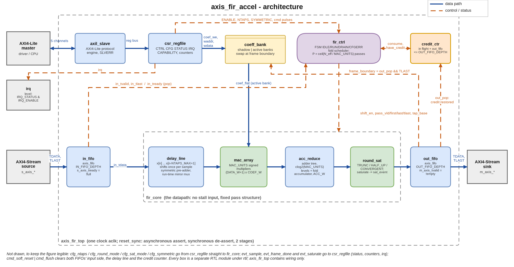
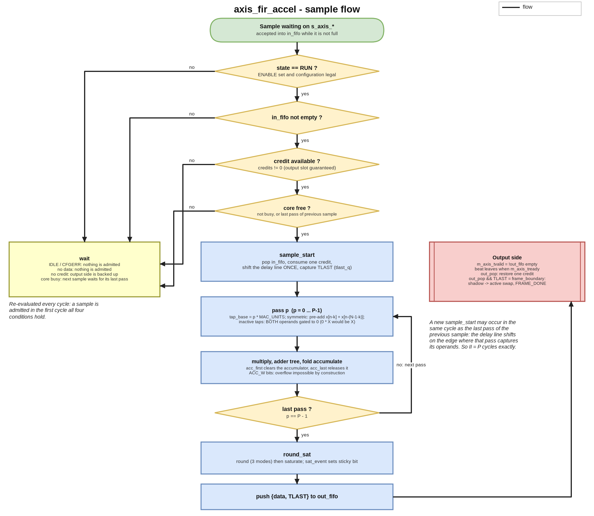
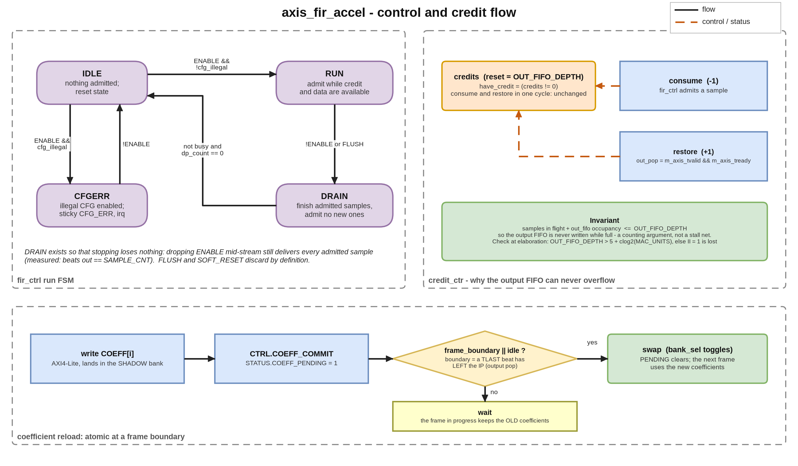

## A. Project overview

### A.1 Purpose

`axis_fir_accel` is a programmable fixed-point FIR filter accelerator. It computes `y[n] = sum_k h[k] * x[n-k]` with Q1.15 samples and
coefficients and a tap count set at run time (1 to `NTAPS_MAX`), and it has an AXI4-Stream sample interface and an AXI4-Lite control
interface. It's a compute-unit design: the interesting parts are the arithmetic datapath, the way its multipliers fold, and a
flow-control scheme that never stalls the arithmetic pipeline.

### A.2 Problem statement and motivation

Streaming DSP blocks tend to fail quietly in one of two ways. Either the arithmetic is slightly wrong while every protocol check still
passes (a delay line that shifts once per pass instead of once per sample is the classic case), or flow control gets added late as a
global stall that turns into a timing-critical net that is hard to reason about. I built this design to avoid both. Results are compared
bit for bit with an independent integer model at every fold factor, and back-pressure goes through a credit counter instead of a stall
net.

### A.3 Scope and requirements (as implemented)

| ID | Requirement | Status |
|---|---|---|
| R1 | `y[n] = sum h[k] x[n-k]`, Q1.15, run-time `1 <= N <= NTAPS_MAX` | implemented, simulated, bit-exact vs the model |
| R2 | Accumulator that cannot overflow, with the width derived rather than guessed | implemented; derivation checked by script and by the peak accumulator value in simulation |
| R3 | Three rounding modes, symmetric / asymmetric saturation, sticky saturation status | implemented, simulated at the exact boundaries |
| R4 | Linear-phase (symmetric) pre-adder, including the odd-length centre tap | implemented, simulated (N = 1 to 64, odd and even) |
| R5 | `MAC_UNITS` resource folding: `II = ceil(N_eff / MAC_UNITS)` | implemented, simulated at six fold factors |
| R6 | Lossless, order-preserving, `TLAST`-aligned streaming; no combinational `TREADY` path | implemented, simulated; structural check on the elaborated netlist |
| R7 | AXI4-Lite CSRs with byte strobes, `SLVERR` policy, RW1C interrupt | implemented, simulated |
| R8 | Atomic coefficient reload at a frame boundary (shadow / active bank) | implemented, simulated |
| R9 | Synthesis and static timing | synthesised and timed pre-layout on Sky130 HD with Yosys 0.33 and OpenSTA (one build, six fold factors) |
| R10 | Dual clock domain, formal proof, power | **NOT DONE / NOT MEASURED** (specified or planned in the project plan; see section I) |
| R11 | Bound SVA on the interfaces, flow-control and control invariants, cover points, and a campaign that shows the checks can fail | implemented, measured (G.8); it found a defect (G.9) |

### A.4 Target application and concepts

It fits any streaming filter: a channel filter or decimation stage behind an ADC, an audio equaliser, a moving average. Along the way it
covers fixed-point bit-growth analysis, rounding and saturation, pre-adder symmetry, time-multiplexed multipliers (folding), elastic
buffers, credit-based flow control, reconfiguration through shadow registers, and CSR design.

### A.5 Key features and measurable objectives

- 16-bit samples and coefficients, and a 38-bit accumulator at `NTAPS_MAX = 64` (`ACC_W = DATA_W + COEF_W + clog2(NTAPS_MAX)`).
- An initiation interval equal to the prediction `ceil(N_eff / MAC_UNITS)`: measured 4.027 against 4, 2.027 against 2 and 1.028 against 1
  at `MAC_UNITS = 8`.
- Bit-identical output for `MAC_UNITS` in {1, 2, 4, 8, 16, 32}.
- One measured area, period and throughput curve over `MAC_UNITS`, all from the same RTL (section H).

---

## B. Architecture and block diagram

### B.1 Overview

`axis_fir_top` is purely structural. A control plane (`axil_slave`, `csr_regfile`, `coeff_bank`) configures a data plane (`in_fifo`,
`fir_ctrl` with `credit_ctr`, `fir_core`, `out_fifo`), and `fir_core` holds the arithmetic: `delay_line`, `mac_array`, `acc_reduce` and
`round_sat`. The data plane has no stall input. A sample is only admitted when the output FIFO is guaranteed to have a slot for its
result.

### B.2 Blocks and responsibilities

| Block | File | Responsibility |
|---|---|---|
| `reset_sync` | `rtl/common/reset_sync.sv` | asynchronous assert, synchronous de-assert (2 stages) |
| `axil_slave` | `rtl/axi_lite/axil_slave.sv` | AXI4-Lite protocol engine; converts to a one-cycle register bus; accepts AW and W in any order; one outstanding read and write |
| `csr_regfile` | `rtl/control/csr_regfile.sv` | all address decode and register semantics: `ID`, `CAPABILITY`, `CTRL`, `CFG`, `STATUS`, `IRQ_STATUS` (RW1C, set wins), `IRQ_ENABLE`, `SAMPLE_CNT`, `FRAME_CNT`, coefficient window |
| `coeff_bank` | `rtl/mem/coeff_bank.sv` | two coefficient banks; software writes the shadow bank, the datapath reads the active bank; swap when a commit is pending and a frame boundary (or idle) occurs |
| `axis_fifo` (x2) | `rtl/axi_stream/axis_fifo.sv` | elastic buffers carrying `{TDATA, TLAST}`; `s_axis_tready = !full`, `m_axis_tvalid = !empty` |
| `credit_ctr` | `rtl/control/credit_ctr.sv` | admission credits; the whole flow-control mechanism |
| `fir_ctrl` | `rtl/control/fir_ctrl.sv` | run FSM (IDLE / RUN / DRAIN / CFGERR), fold scheduler (`pass_*`, `tap_base`), sample admission |
| `delay_line` | `rtl/dsp/delay_line.sv` | sample history; shifts once per sample |
| `mac_array` | `rtl/dsp/mac_array.sv` | `MAC_UNITS` signed multipliers, one product register |
| `acc_reduce` | `rtl/dsp/acc_reduce.sv` | balanced adder tree (one register per level) |
| `fir_core` | `rtl/dsp/fir_core.sv` | operand / coefficient select, pass-record delay chain, fold accumulator, output register |
| `round_sat` | `rtl/dsp/round_sat.sv` | the only lossy stage: rounding then saturation |

### B.3 Interfaces

The clock and reset are `aclk` and `aresetn`. There's an AXI4-Lite slave (12-bit address, 32-bit data, `WSTRB` honoured), an AXI4-Stream
slave `s_axis_*` and master `m_axis_*` (`TDATA` 16 bits plus `TLAST`), and a level interrupt `irq`. The parameters are `DATA_W`, `COEF_W`,
`NTAPS_MAX`, `MAC_UNITS` (a power of two), `IN_FIFO_DEPTH`, `OUT_FIFO_DEPTH`, `AXIL_ADDR_W` and `SYMMETRIC_EN`. Elaboration checks that
`MAC_UNITS <= NTAPS_MAX`, that `MAC_UNITS` is a power of two, and that `OUT_FIFO_DEPTH > 5 + clog2(MAC_UNITS)`.

### B.4 Data and control paths

Data goes `s_axis` -> `in_fifo` -> `delay_line` -> `mac_array` -> `acc_reduce` -> fold accumulator -> `round_sat` -> `out_fifo` ->
`m_axis`. On the control side, `fir_ctrl` pops the input FIFO and drives `shift_en`, `pass_vld / first / last / tlast` and `tap_base`.
`credit_ctr` is decremented when a sample is admitted and restored when a beat leaves `out_fifo`, and `csr_regfile` supplies the
configuration to `fir_ctrl` and `fir_core` and collects their status events.

---

## C. Draw.io architecture diagram



The diagram files are in `docs/portfolio/diagrams/`: `fir_architecture.drawio` (editable), `.png` and `.svg`, and the same three for
`fir_flowchart` and `fir_control`. `make_diagrams.py` writes all of them from one specification, so the `.drawio` file is generated rather
than exported from draw.io.

---

## D. Design flowchart





A sample is admitted in the first cycle where the FSM is in `RUN`, the input FIFO isn't empty, a credit is available and the core is free
(either idle or in the last pass of the previous sample). Admission pops the FIFO, uses up a credit and shifts the delay line once. Then
`P` passes follow: the accumulator is cleared on the first pass and released on the last. The result is rounded, saturated and pushed
into the output FIFO. When the beat leaves the IP its credit comes back, and if the beat carried `TLAST`, that's the frame boundary at
which a pending coefficient swap takes effect.

---

## E. Detailed design explanation

### E.1 Fixed-point model and the accumulator width

The operands are signed 16-bit. The largest product magnitude comes from two negative extremes, `(-2^15) * (-2^15) = +2^30`, so
`|acc| <= NTAPS_MAX * 2^30`. A signed `W`-bit value reaches `2^(W-1) - 1`, which makes `ACC_W = DATA_W + COEF_W + ceil(log2(NTAPS_MAX))`
both sufficient and minimal: one bit fewer misses the worst case by exactly one LSB. The symmetric pre-adder widens each operand by one
bit but halves the number of products, and the two effects cancel exactly, so the same `ACC_W` covers both forms. That's why the
accumulator has no saturation logic and no overflow flag, and `round_sat` is the only place where information is lost.

### E.2 Datapath and the fold schedule

`P = ceil(N_eff / MAC_UNITS)`, where `N_eff = ceil(N/2)` in symmetric mode and `N` otherwise. When a sample is admitted the delay line
shifts, and over the next `P` cycles pass `p` handles taps `p * MAC_UNITS` to `p * MAC_UNITS + MAC_UNITS - 1`. Each pass selects the
operands (in symmetric mode the near tap plus the far tap `N-1-k`, with the centre tap of an odd-length filter counted once), selects the
coefficients, multiplies, reduces through the adder tree and accumulates across passes. A new sample can be admitted in the same cycle as
the last pass of the previous one, because a register reads its value from before the edge, so `II = P` exactly.

**The delay line shifts once per sample, not once per pass.** If it advanced once per pass, the block would still stream correctly,
break no protocol rule, set no status bit and quietly return wrong numbers. An assertion wouldn't catch that. What catches it is the
requirement that every `MAC_UNITS` setting gives output bit-identical to a model that knows nothing about folding.

### E.3 Pipeline and latency

After the select cycle come the operand and coefficient register, the product register, `clog2(MAC_UNITS)` adder-tree registers, the
fold accumulator and result register, and the output register. The latency from admission to the output register is
`LATENCY = 5 + clog2(MAC_UNITS) + (P - 1)` cycles. It depends on the configuration, but it's deterministic and doesn't depend on the data.
The pass record `{vld, first, last, tlast}` is shifted through exactly the same delay as the datapath, so `out_valid` and `TLAST` come out
aligned with their sample and no side FIFO is needed.

### E.4 Rounding and saturation

`round_sat` converts the `Q(ACC_W-30).30` accumulator to Q1.15. It truncates, rounds half up, or rounds convergently (half to even), then
saturates either asymmetrically to `[-32768, 32767]` or symmetrically to `[-32767, 32767]`, with a sticky status bit and an interrupt. The
reserved rounding code is rejected by the configuration-legality check (`CFGERR`) before it can reach the datapath.

### E.5 Flow control

`credits` resets to `OUT_FIFO_DEPTH`. Admitting a sample needs `credits != 0` and decrements it, and a beat leaving the output FIFO
increments it. Each admitted sample produces exactly one output, so `samples in flight + out_fifo occupancy <= OUT_FIFO_DEPTH` always
holds, and the output FIFO can never be written while it's full, whatever the pipeline depth, the fold factor or the downstream behaviour.
Back-pressure travels upstream through occupancy (the output FIFO fills, the credits run out, admission stops, the input FIFO fills, and
`s_axis_tready` falls) and never through combinational logic, so `s_axis_tready` has no combinational dependence on `m_axis_tready`. I
decided against a global stall net because it would become a high-fan-out, timing-critical signal, create a combinational cone from the
downstream `TREADY` to the upstream one, and make it harder to argue that nothing gets lost.

### E.6 Coefficient reload

Coefficient writes go into the shadow bank. `CTRL.COEFF_COMMIT` sets `STATUS.COEFF_PENDING`, and the banks swap in the cycle a `TLAST`
beat leaves the output FIFO, or straight away when the block is idle. Taking the boundary from the output side guarantees the swap can't
happen in the middle of a frame that is still being computed. The coefficient storage is never reset (resetting the biggest register
array buys nothing, because software has to write the coefficients first anyway), so entries above `NTAPS` can be X. Both multiplier
operands are therefore gated by the active-tap flag, since `0 * X` is `X` in Verilog. A test found this, not a code review.

### E.7 Reset, errors and corner cases

Reset is asserted asynchronously and released synchronously. It clears the delay line, the FIFO pointers and the FSM and refills the
credits, but leaves the coefficient arrays alone. `SOFT_RESET` and `FLUSH` clear the input side, the delay line and the pipeline but keep
the output FIFO, because dropping `TVALID` on a beat that has already been offered would break AXI4-Stream. An illegal configuration
(`NTAPS` of 0 or above `NTAPS_MAX`, or the reserved rounding code) holds the FSM in `CFGERR`, sets a sticky bit and raises the interrupt.
`DRAIN` finishes every admitted sample before stopping, and a `CFG` write while `STATUS.BUSY` is set returns `SLVERR` and changes nothing.

### E.8 Design decisions and trade-offs

| Decision | Alternative | Reason / cost |
|---|---|---|
| Credit counter | global stall net | no timing-critical enable fan-out, no combinational ready path, a counting argument for losslessness; costs one counter and a minimum `OUT_FIFO_DEPTH` |
| Derived accumulator width | wide accumulator + saturation | no saturation or overflow logic in the accumulator; the width is checked by script |
| Fold factor as a parameter | separate RTL per configuration | one source covers II = N down to II = 1 |
| Pass record shifted with the datapath | fixed-depth valid pipe | latency tracks the run-time configuration without arithmetic on `P` |
| Register-array coefficient banks | RAM macro | both banks readable in parallel; this is the dominant flop cost at large `NTAPS_MAX` |
| Variable latency (depends on `NTAPS` and `SYMMETRIC`) | fixed worst-case latency | documented and exact; an integrator cannot assume a constant |

---

## F. Interface and timing details

AXI4-Lite: the address is a 12-bit byte address, `WSTRB` is honoured on every writable register, AW and W can arrive in either order,
there's no combinational path from `BREADY` or `RREADY` to the ready signals, and every write gets exactly one B response. A write takes
three cycles, because `AWREADY` is held low while a response is outstanding; this is configuration traffic, so bandwidth doesn't matter.
Unmapped addresses, coefficient indices at or above `NTAPS_MAX` and `CFG` writes while busy return `SLVERR`, and a write to a read-only
register returns `OKAY` and is ignored.

Register map (offsets from the base address): `0x000 ID` (`"FIR0"`), `0x004 CAPABILITY` (build parameters readable at run time), `0x008 CTRL` (`ENABLE`, W1P `SOFT_RESET`, `COEFF_COMMIT`, `FLUSH`, `CNT_CLR`), `0x00C CFG` (`NTAPS`, `ROUND_MODE`, `SAT_MODE`, `SYMMETRIC`), `0x010 STATUS`, `0x014 IRQ_STATUS` (RW1C), `0x018 IRQ_ENABLE`, `0x01C SAMPLE_CNT`, `0x020 FRAME_CNT`, `0x400 + 4i COEFF[i]`.

AXI4-Stream: `TDATA` and `TLAST` stay stable while `TVALID && !TREADY`, because the output is the FIFO's read register. `s_axis_tready` is
high during reset on purpose, since a compliant master doesn't present anything then. The synthesis run assumes inputs arrive 0.35 ns after
the clock edge and outputs are needed 0.15 ns before the next one, at the typical corner with an ideal clock and no wires
(`constraints/axis_fir_top.sdc`).

---

## G. Verification and testing

### G.1 Verification environment

The testbench is cocotb 2.x on Icarus Verilog 12. It has an AXI4-Lite driver with a protocol monitor, an AXI4-Stream driver and sink with
a protocol monitor, and a **bit-exact integer reference model** (`tb/cocotb/model/fir_ref.py`). The model uses integer arithmetic only and
mirrors the RTL line for line, so every comparison is exact equality with no tolerance. I checked the model itself against a
floating-point convolution: the worst difference is 0.4999 LSB, the exact bound for correct rounding. There are four suites, each with
its own wrapper in `tb/sv/`: control plane (18 tests, two of them added in revision 3), stream and flow control (12), arithmetic (12) and
full integration (15, eight of them added in revision 3, see G.8 and G.10). It's a Python environment with directed and
constrained-random tests, not UVM. The same suites also run under Verilator 5.052 with the bound assertions and cover points (G.8).
There's **no formal proof**.

### G.2 Measured results

```text
Control plane, stream path and full integration (baseline `make check`, default builds):
  AXI4-Lite control plane : TESTS=16 PASS=16 FAIL=0 SKIP=0
  AXI4-Stream flow control: TESTS=12 PASS=12 FAIL=0 SKIP=0 (largest run: 100000 beats matched exactly)
  full IP, MAC_UNITS=8    : TESTS=7 PASS=7 FAIL=0 SKIP=0
    initiation interval  N=32 sym=0 MAC_UNITS=8 -> predicted 4, measured 4.027
    initiation interval  N=32 sym=1 MAC_UNITS=8 -> predicted 2, measured 2.027
    initiation interval  N=8 sym=0 MAC_UNITS=8 -> predicted 1, measured 1.028
    initiation interval  N=1 sym=0 MAC_UNITS=8 -> predicted 1, measured 1.028
    1800 samples across 6 configurations: BIT-EXACT (MAC_UNITS=8)
    elab_sweep: all configurations clean (no latches, no tri-states, no loops)
    RESULT: derivation holds
    worst |model - float| = 0.4999 output LSB (N=8, symmetric=False)
    comb-independence: all checks pass (6 properties on axis_fir_top)

Parameter sweeps (make sweep): control plane at five (NTAPS_MAX, MAC_UNITS, SYMMETRIC_EN) builds, stream path at five FIFO / pipe configurations:
  csr: NTAPS_MAX=64 MAC_UNITS=8 SYM=1          TESTS=16 PASS=16 FAIL=0 SKIP=0
  csr: NTAPS_MAX=32 MAC_UNITS=4 SYM=1          TESTS=16 PASS=16 FAIL=0 SKIP=0
  csr: NTAPS_MAX=16 MAC_UNITS=8 SYM=1          TESTS=16 PASS=16 FAIL=0 SKIP=0
  csr: NTAPS_MAX=128 MAC_UNITS=16 SYM=1        TESTS=16 PASS=16 FAIL=0 SKIP=0
  csr: NTAPS_MAX=256 MAC_UNITS=1 SYM=0         TESTS=16 PASS=16 FAIL=0 SKIP=0
  stream: D=16 IN=8 OUT=8 PIPE=4               TESTS=12 PASS=12 FAIL=0 SKIP=0
  stream: D=16 IN=2 OUT=4 PIPE=2               TESTS=12 PASS=12 FAIL=0 SKIP=0
  stream: D=16 IN=4 OUT=32 PIPE=16             TESTS=12 PASS=12 FAIL=0 SKIP=0
  stream: D=8 IN=8 OUT=8 PIPE=1                TESTS=12 PASS=12 FAIL=0 SKIP=0
  stream: D=32 IN=16 OUT=16 PIPE=8             TESTS=12 PASS=12 FAIL=0 SKIP=0

Fold sweep (make fold-sweep): full-IP suite (7 tests) at NTAPS_MAX=32 for every MAC_UNITS; all runs bit-identical to the fold-agnostic model:
  MAC_UNITS=1                        TESTS=7 PASS=7 FAIL=0 SKIP=0
  MAC_UNITS=2                        TESTS=7 PASS=7 FAIL=0 SKIP=0
  MAC_UNITS=4                        TESTS=7 PASS=7 FAIL=0 SKIP=0
  MAC_UNITS=8                        TESTS=7 PASS=7 FAIL=0 SKIP=0
  MAC_UNITS=16                       TESTS=7 PASS=7 FAIL=0 SKIP=0
  MAC_UNITS=32                       TESTS=7 PASS=7 FAIL=0 SKIP=0

Arithmetic suite on the final RTL (repaired wrapper, one pass per sample, MAC_UNITS = NTAPS_MAX):
  NTAPS_MAX=16: TESTS=12 PASS=12 FAIL=0 SKIP=0
      LATENCY = 9 cycles, ACC_W = 36 bits (both confirmed)
      peak |accumulator| = 17179869184, ACC_W bound = 34359738368 (50.0% of range, never exceeded)
      24000 samples across 20 coefficient sets, all 6 mode pairs: BIT-EXACT
  NTAPS_MAX=64: TESTS=12 PASS=12 FAIL=0 SKIP=0
      LATENCY = 11 cycles, ACC_W = 38 bits (both confirmed)
      peak |accumulator| = 68719476736, ACC_W bound = 137438953472 (50.0% of range, never exceeded)
      24000 samples across 20 coefficient sets, all 6 mode pairs: BIT-EXACT
  large random run (make fir-full NTAPS_MAX=16, RAND_SETS=20 RAND_LEN=50000):
      TESTS=12 PASS=12 FAIL=0 SKIP=0
      1000000 samples across 20 coefficient sets, all 6 mode pairs: BIT-EXACT
```

That block was recorded before revision 3 added tests, when the control-plane suite had 16 tests and the full-IP suite 7. Now they have
18 and 15 (G.1). The revision-3 runs with the added tests are in `results/sva/runs.txt` (18 configurations) and
`_evidence/rev3/axis_fir_accel.make_check.log` (`make check`: 18, 12, 12 and 15 tests, all passing).

### G.3 What the arithmetic suite checks

It checks that the impulse response equals the coefficients and that a boxcar matches its closed form. It drives extreme operands
(full-scale negative inputs and coefficients, which reach exactly `2^36` at 64 taps, 50.0 % of the representable range), rounding at
exact ties in all three modes (and that the modes can be told apart), and saturation at the exact clamp points in both modes. It checks
that symmetric equals asymmetric for every N from 1 to 64, every tap count, gaps in the input, a delay-line flush, and the latency and
`ACC_W` against the derivation. It finishes with the large random run over many coefficient sets and all six rounding and saturation
mode pairs.

### G.4 Structural checks

Elaborating through Yosys at five parameter sets shows no latches, no tri-states and no combinational loops, and that check tests itself.
A netlist check on the shipping top level proves six properties of combinational independence. Among them: there's no path from
`m_axis_tready` to `s_axis_tready`, no feed-through from `s_axis_tvalid` to `m_axis_tvalid` or from `s_axis_tdata` to `m_axis_tdata`, and
none into the AXI4-Lite ready signals. The netlist check is itself tested on a direct-wire example and a through-a-flop example.

### G.5 A verification finding made while building this portfolio

The original `make check` printed a "Phase 3 suite" header with no result and still returned success. When I reproduced the suite, it
turned out that `tb/sv/fir_core_wrap.sv`, the arithmetic suite's wrapper, no longer elaborated after the Phase 4 refactor replaced the
unfolded `fir_core` interface (`in_valid`, `in_last`, `LATENCY`) with the folded one (`shift_en`, `pass_*`, `tap_base`). The Makefile's
`... | grep ... || true` pattern turned the failure into silence, so the arithmetic claims in the original README (bit-exact, peak
accumulator, latency) couldn't be reproduced from the final RTL. In this copy I rebuilt the wrapper to drive the folded core at one pass
per sample (`MAC_UNITS = NTAPS_MAX`), updated the latency expectation to the folded core's `5 + clog2` (the Phase 3 core was
`4 + clog2`), kept the original wrapper in `tb/sv/original/`, and made every suite target fail if it prints no summary or any failure
(`scripts/run_suite.sh`). The arithmetic results in G.2 come from the repaired suite on the final RTL.

### G.6 Simulation commands and tool requirements

```bash
make check            # all suites + structural checks (fails if any suite does not pass); Icarus, no assertions
make sva              # the same suites under Verilator 5.052 with the bound checkers (96 s from a cold start and 20 s once built, both measured with --jobs 7)
make sva-mutants      # the injected-bug campaign, 95 mutants (1625 s with scripts/sva_mutants.py --jobs 7 on 8 cores; the default is 4 jobs)
make sva-equiv        # Yosys proof that the two surviving mutants are equivalent, with six real faults as controls (64 s)
make fir NTAPS_MAX=64 # arithmetic suite at the full width
make fir-full NTAPS_MAX=16   # the large random run (see G.2 for the exact sample count)
make fold-sweep       # six fold factors, bit-identity
make sweep            # parameter sweeps of the control and stream suites
make ppa-sweep        # Yosys + OpenSTA over MAC_UNITS (section H)
```

Tools: Icarus Verilog 12.0, cocotb 2.0.1, Python 3 with numpy, Yosys 0.33 and OpenSTA 2.7.0. `make sva` and `make sva-mutants` also need
Verilator 5.052 built from source (cocotb 2.x needs 5.036 or later, the checkers use sequence delays, and the system package is 5.020).
They find it through `VERILATOR_5052` (default `../../_toolchain/verilator-5.052`, relative to the project folder).

### G.7 Known gaps

There's no formal proof (the assertions are only checked in simulation, in 18 configurations), no UVM-style functional-coverage model
(coverage is cover properties plus the antecedent covers of G.8) and no gate-level simulation, and the CDC / dual-clock mode is specified
but not implemented. The long random run is at 16 taps rather than 64 because, as the original engineering log records, Icarus is very
slow on the fully parallel 64-multiplier build (it reports roughly 40 cycles per second, a figure I haven't re-measured). The arithmetic
under test only depends on `NTAPS_MAX` through `ACC_W` and the array size, but this is a simulator limit, and I don't claim coverage at
64 taps.

### G.8 Bound assertions, cover points and an injected-bug campaign

`verif/fir_checkers.sv` holds assertions (labelled `a_*`), cover points (`c_*`) and four procedural scoreboard checks (`sb_*`).
`verif/fir_binds.sv` binds them into the AXI4-Lite slave, both instances of the stream FIFO, the credit counter, the control FSM and pass
sequencer, the coefficient banks, the register file, the delay line, the datapath output stage and the top level. Because they're attached
with `bind`, the checkers need no change to the RTL, and the same checkers run in every cocotb suite that instantiates the module. Each
assertion names the requirement it comes from (`docs/01_requirements.md`, for example FR-10, FR-12, FR-15, FR-19, FR-21 to FR-25), or says
"design rule" where the rule is stated in an RTL header (the credit invariant, and the FIFO's ready and valid depending only on
occupancy). The groups are:

- **AXI4-Lite protocol**: responses held until accepted, one outstanding write and one read, response codes follow the register bus error flag.
- **Stream FIFO**: occupancy bookkeeping, TREADY / TVALID are functions of occupancy only (TR-04), payload stable until taken (FR-19), and an order scoreboard.
- **Credit counter and top level**: credits are spent only when available, and `credits + samples in the datapath + beats in the output FIFO = OUT_FIFO_DEPTH` exactly, so a push can never find the FIFO full; a TLAST scoreboard (FR-15, FR-17) is re-armed after a flush.
- **Control FSM**: every transition arc, admission only while running with a credit, the delay line shifts once per sample (design risk R3), the pass sequencer runs exactly the configured number of passes.
- **Coefficient banks, registers, delay line, saturation**: swap only at a frame boundary or while idle (FR-10, FR-11), CFG write refused while busy (FR-12), unmapped accesses refused (FR-24), sticky error and saturation flags (FR-22, FR-23), level interrupt (FR-25), zero-fill on flush (FR-04), symmetric saturation never reaches -2^(W-1) (FR-06).

For every conditional assertion (one with an implication), `scripts/gen_vacuity.py` generates a second cover for its antecedent, so a
simulation shows whether the precondition was ever met. An assertion that only passed because its antecedent never happened is reported
as a problem, not as a pass. The simulations (`scripts/run_sva.py`) are the repository's own cocotb suites in 18 configurations: five
control-plane builds, five stream builds, two arithmetic builds and six folded builds of the full IP.

```text
FIR accelerator: bound checkers under cocotb + Verilator 5.052 (18 runs, unmodified RTL)
runs                      : 18, all tests passed and no assertion fired: yes
assertions defined        : 105 labelled (101 concurrent, 4 procedural scoreboard checks)
conditional assertions    : 80, antecedent reached in at least one run: 80
cover bins                : 81, hit: 81, zero: 0 (excluded with a reason: 0)
note                      : gen_vacuity: 80 conditional assertions got an antecedent cover; 20 unconditional (never vacuous): a_ren_is_hs, a_count_range, a_full_def, a_empty_def, a_tready_def, a_tvalid_def, a_range, a_have_def, a_status_busy, a_status_drain, a_consume_def, a_ready_eq, a_shift_eq, a_pass_first, a_pass_last, a_tap_base, a_illegal_def, a_irq_level, a_credit_inv, a_out_bound
problems                  : none
```

Writing the covers showed that the existing suites had never produced several situations, so I added seven directed tests to the
integration suite (`tb/cocotb/tests/test_top.py`): CTRL.FLUSH and CTRL.SOFT_RESET with samples inside the IP, the interrupt output,
leaving the configuration-error state, back-to-back one-beat frames, commit requests landing on and next to a bank swap, a register read
while a write response is pending, and (G.9) credit integrity after a flush. Three more came from the injected-bug campaign (G.10): a read
and a write offered while the previous response is stalled (control-plane suite), and a consumer stopped from reset (integration suite).
That makes ten directed tests in all. The control-plane suite now has 18 tests (16 before) and the integration suite 15 (7 before), and
the same command runs the directed tests and the checkers.

**Checking the checks.** `scripts/sva_mutants.py` applies each injected bug in its list to a copy of the RTL, runs the cocotb suites that
contain the edited module with the checkers bound, and records whether a cocotb test failed and which assertions fired. The checkers don't
change behaviour, so one run answers both questions. There are 95 mutants in two groups. The first 48 (`M01` to `M48`) come from the
design's own risks: a response dropped without its ready, a FIFO that pops without a taker, a credit that is never returned, the delay
line shifting per pass instead of per sample, a coefficient commit that swaps inside a frame, and so on, ending with the flush defect of
G.9. The other 47 (`Q01` to `Q47`) I wrote afterwards, one for each assertion that none of the first 48 had made fire, because a campaign
that never makes an assertion fire hasn't shown that the assertion can fail. A run counts as caught by the tests only if a cocotb test
failed or the run hit a 300 s hang limit, in which case it's killed with its whole process group. Nine mutants made a test wait forever,
and each of them also made an assertion fire. A run that the checkers stopped themselves (the simulator's error limit) counts as caught
by an assertion, and a label that matches no defined assertion, or a label defined twice, stops the campaign instead of being counted.
The result (`results/sva/mutants.txt`, first lines):

```text
mutants: 95, caught 93 (by tests 78, by an assertion only 15), survived 2, invalid 0
caught ONLY by an assertion (the cocotb tests missed them): M08, M19, M24, M28, M29, M33, M38, M42, Q14, Q19, Q20, Q25, Q28, Q37, Q44
survivors (each with its reason, confirmed by results/sva/equivalence.txt): Q12, Q17
assertions defined: 105; fired in at least one mutant run: 105
assertions that fired in no run: none
assertions no RTL edit can violate (reason in verif/sva_unviolable.txt): none
mutants whose expected assertion did not fire (another one did): none
PROBLEMS: none
```

### G.9 A defect found by the assertions: a flush loses beats later

The first baseline run of the checkers on the unmodified RTL was clean, and so was every existing test. Then the cover points showed that
no test issued CTRL.FLUSH or CTRL.SOFT_RESET while samples were flowing. A directed test that does (`test_flush_keeps_credit_invariant`)
made `a_credit_inv`, `a_dp_nonneg`, `a_return_room`, `a_range`, `a_no_drop` and the RTL's own `credit_ctr` `$error` fire. After a flush
the credit count stayed above the free space in the output FIFO, and after three flushes mid-stream and a long consumer stall only 89 to
95 of 96 offered samples came out of the IP (the exact number depends on the fold factor). Beats were being lost at the output FIFO,
which ignores backpressure by design because the credits are supposed to make overflow impossible.

The cause was that `fir_core`'s `clear` zeroed the delay line but not the pipeline's control chain or result registers. Samples admitted
before the flush therefore came out after `fir_ctrl` and `credit_ctr` had been reconciled as if those samples were gone (`fir_ctrl`
clears its in-flight count, and `credit_ctr` reloads `OUT_FIFO_DEPTH - beats buffered`). The top-level comment and requirement FR-14 both
say a flush drops the pipeline. The fix is three small edits in `rtl/dsp/fir_core.sv`: the control chain, the result valid and the output
valid register now honour `clear`. The file as I found it is kept in `verif/as_found/fir_core.sv` and is injected again as the last
mutant of the campaign, which the assertions catch. After the fix every configuration passes, `make check` passes, and I re-ran the
synthesis sweep (H.2; the largest change is 2.2 %, and `results/ppa/ppa_sweep_before_flush_fix.md` has the earlier numbers).

### G.10 What the campaign showed about the tests and the design

**Stimulus the tests never produced.** The driver never overlaps requests, so in the first campaign three mutants of the AXI4-Lite slave
were invisible to every cocotb test. `M05` (ARREADY ignores an unanswered read) and `M06` (a new write accepted while a response is
outstanding) were caught only by assertions, and `M07` (the register-read strobe follows ARVALID instead of the handshake) wasn't caught
at all, because the strobe has no consumer in the register file and no master ever offered a second read while the first response was
waiting. Two directed tests now hold ARVALID, or AWVALID and WVALID, high across a stalled response. They check that nothing is accepted,
that the response doesn't change, that the independent channel still returns the old value, and that the register bus sees one strobe per
accepted request, and with them all three mutants are caught by a test as well (the test reads the strobe by hierarchical reference).

The credit pool was a similar story. A pool four entries larger than the output FIFO, with an output FIFO twice as deep (`Q45`), passes
every data check because the extra beats are simply buffered. The new test stops the consumer from reset and requires the IP to take
exactly `OUT_FIFO_DEPTH + IN_FIFO_DEPTH` samples (24 at the default build). The design does, and `Q45` doesn't (28). Only once that test
existed did `a_out_bound` have a mutant that fires it. My first version of `Q45` was undone by the testbench itself: configuring the IP
issues a soft reset, which reloads the credit counter from `credit_reload`, so the larger pool has to be changed there too.

**Dead logic in the control FSM.** Two mutants, `Q12` (the idle FSM leaves IDLE on a flush command) and `Q17` (the RUN arm ignores the
flush term), survived all runs. Both edit the flush term in `fir_ctrl`'s next-state logic, and that term can never matter: the top level
ties `soft_clear = cmd_soft_reset | cmd_flush`, and `fir_ctrl` gives `soft_clear` priority over its next-state function. The idea came
from reading the RTL, and `scripts/check_equivalent.py` tests it on the netlist. Both designs are elaborated and flattened, every register
and port is paired by name, and Yosys `equiv_simple` / `equiv_induct` prove all 391 paired bits (of the registers and outputs) equal in
every cycle for every input sequence, by induction from equal states, for one small parameter set (`DATA_W = COEF_W = 4`,
`NTAPS_MAX = 2`, `MAC_UNITS = 1`). The same script does **not** prove six mutants that really do change behaviour
(`results/sva/equivalence.txt`), and that's what makes the proof worth anything.

I restricted the pairing to registers and ports on purpose. Pairing every named wire let the induction assume pairs equal that it hadn't
proved, and it was the negative controls that showed the method wasn't sound yet (a first version that didn't flatten the design
"proved" a clearly different mutant equivalent). I left the FSM's flush term in the RTL, since removing it is a design decision rather
than a verification one, and the survivors are reported as equivalent, not as caught.

**Assertions that restate each other.** `a_out_bound` (the output FIFO never holds more than `OUT_FIFO_DEPTH`) follows arithmetically
from `a_credit_inv` and the non-negativity of the other two terms, and only a design that buffers more than the contract allows can make
it fire at all (`Q45` makes it fire together with `a_credit_inv`). It's still worth having because it names the property.

**Two defects in the verification itself, found and fixed on the way.** cocotb's log lines were landing in the middle of Verilator's
"Assertion failed" lines in the shared pipe, so some firings were attributed to truncated labels. The simulator output is now
line-buffered, and the campaign refuses a label that matches no assertion. Two checkers had also used the same label (`a_hold` in the
FIFO and in the delay line), which made a firing impossible to attribute; I renamed one, and duplicates are now an error.

---

## H. Synthesis, timing and performance results

### H.1 Method

Yosys 0.33 synthesises the design to Sky130 HD (`sky130_fd_sc_hd__tt_025C_1v80`) and OpenSTA times it, at `NTAPS_MAX = 64` with 16-bit data
and coefficients, `SYMMETRIC_EN = 1` and a timing-driven ABC mapping. The period is derived as `T_min = 10 ns - WNS` at a 10 ns target and
**verified** by re-running at `T_min` +/- 2 % (the check column). The asynchronous-reset network is left out of the clock-path analysis and
reported separately for information. Everything is pre-layout, with an ideal clock and no wires.

### H.2 Results

Build: NTAPS_MAX=64, DATA_W=COEF_W=16, SYMMETRIC_EN=1. Timing-driven ABC mapping. Boundary: inputs 0.35 ns after the edge, outputs 0.15 ns before the next edge (assumption). The asynchronous-reset network is excluded (see constraints/axis_fir_top.sdc). T_min = 10 ns - WNS, verified at +/-2 %.

| MAC_UNITS | II (cycles/sample) | cells | area (um^2) | flip-flops | T_min (ns) | F_max (MHz) | throughput (Msamples/s) | method check |
|---:|---:|---:|---:|---:|---:|---:|---:|---|
| 1 | 32 | 18662 | 200006 | 3860 | 5.392 | 185.5 | 5.80 | verified (+0.107 / -0.108 ns) |
| 2 | 16 | 20743 | 222904 | 3964 | 5.460 | 183.2 | 11.45 | verified (+0.109 / -0.109 ns) |
| 4 | 8 | 25497 | 265551 | 4169 | 5.286 | 189.2 | 23.65 | verified (+0.105 / -0.106 ns) |
| 8 | 4 | 33370 | 344493 | 4578 | 5.198 | 192.4 | 48.10 | verified (+0.104 / -0.104 ns) |
| 16 | 2 | 49537 | 486684 | 5392 | 5.266 | 189.9 | 94.95 | verified (+0.105 / -0.106 ns) |
| 32 | 1 | 77787 | 760277 | 7016 | 5.405 | 185.0 | 185.01 | verified (+0.108 / -0.108 ns) |

Throughput = F_max / II, a derived figure: II = ceil(N_eff / MAC_UNITS) with N_eff = NTAPS_MAX/2 for the symmetric build (documented in docs/03_microarchitecture.md; the cocotb fold-sweep checks bit-exactness at every MAC_UNITS). Worst asynchronous-reset recovery slack at 10 ns, unbuffered reset net (informational, NOT a pass/fail figure): M=1: -32.033 ns, M=2: -35.147 ns, M=4: -41.285 ns, M=8: -53.53 ns, M=16: -77.899 ns, M=32: -126.522 ns

### H.3 Reading the table

`MAC_UNITS` buys throughput at a cost in cells. Across the sweep the cell count and area grow with `MAC_UNITS`, while the derived period
stays within a narrow band (see the table) with no trend, and throughput scales with `1 / II`. Throughput is derived (`F_max / II`), not
measured in the synthesis flow; `II` itself is measured in simulation at `MAC_UNITS = 8`. The netlist is flattened, so this flow can't
attribute the critical path to a named block (**NOT MEASURED**). Frequency after place and route, power and Nangate45 results are
**NOT MEASURED** either.

---

## I. Results, limitations and future improvements

### I.1 Summary

This is a parameterised FIR accelerator whose output is bit-identical to an independent integer model at every fold factor I measured. It
has an accumulator that is provably sufficient and minimal, credit-based flow control that keeps the arithmetic pipeline free of stalls,
atomic coefficient reload, and a measured area, period and throughput sweep over its main parameter. Its bound assertions and cover points
have been shown able to fail by an injected-bug campaign (G.8), and the checking led to a flush defect that the tests had missed and that
I then fixed (G.9).

### I.2 Most meaningful outcomes

1. Bit-identity across fold factors, so the dangerous per-pass versus per-sample shift bug can't hide behind protocol checks.
2. An accumulator width that is derived, with a tight bound that is checked.
3. Credit-based admission with a counting argument for losslessness, and a structural proof that there's no combinational `TREADY` path.
4. A measured `MAC_UNITS` sweep from one source (G.2 and H.2).
5. Repairing a regression that had silently broken, and making the build fail loudly (G.5).
6. Assertions with antecedent covers, and an injected-bug campaign that found a real defect (a flush that later loses beats) and showed
   which checks only the assertions can see (G.8, G.9).

### I.3 Limitations

A single clock domain; the assertions are only checked in simulation, with no formal proof; coverage is cover properties rather than a
UVM-style model; timing is pre-layout only, on Sky130 HD only, with a flattened netlist; the latency varies with the configuration; only
one coefficient set is active at a time; the coefficients are stored in a register array (area), not RAM; and the long random run is at
16 taps.

### I.4 Future improvements

A formal proof of the credit invariant (the assertion `a_credit_inv` states it); a functional-coverage model driven by the random run; the
dual-clock split between control and data with proper CDC; RAM-based coefficient storage; place and route and a named critical path; and,
as a measured experiment, registering every second adder-tree level (fewer flops, deeper logic).

### I.5 Interview talking points

- Why the per-pass delay-line shift is the worst bug you can have in a folded FIR, and how bit-identity catches it.
- The accumulator-width derivation, why the two negative extremes set the bound, and why the symmetric form needs no extra bit.
- The credit counter versus a global stall: the three reasons, and the counting argument.
- Why gating only one multiplier operand fails in simulation (`0 * X`).
- Why the coefficient swap boundary is taken from the output side.
- The G.5 story: how a regression that printed nothing and returned success stayed hidden for several phases.
- The G.9 story: the credit invariant held in every test until a cover point showed that no test flushed mid-stream; what the assertion
  said, why the output FIFO lost beats, and how the file as I found it is kept as a mutant.

---

## J. References and reproducibility

- AMBA AXI and ACE Protocol Specification (AXI4-Lite, AXI4-Stream), Arm; Yosys, OpenSTA and cocotb documentation; SkyWater SKY130
  `sky130_fd_sc_hd` liberty.
- The original project documents, unchanged in the repository: `docs/00_project_plan.md`, `01_requirements.md`, `02_architecture.md`,
  `03_microarchitecture.md`, `04_interfaces.md`, `05_fixed_point.md` and `engineering_log.md` (decisions D-001 to D-030).
- Directory structure: `rtl/` (15 files), `tb/cocotb/` (drivers, model, four suites), `tb/sv/` (wrappers; `original/` holds the arithmetic
  wrapper from before the repair), `scripts/` (structural checks, width derivation, `run_suite.sh`), `ppa/`, `constraints/`, `results/`,
  `docs/`.
- To reproduce, use the commands in G.6. The source is at https://github.com/AbhijeetJ-512/axis-fir-accel.
